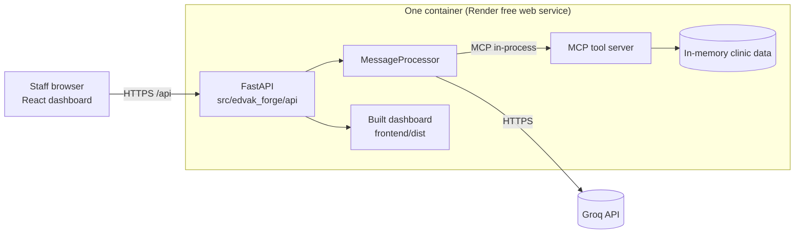
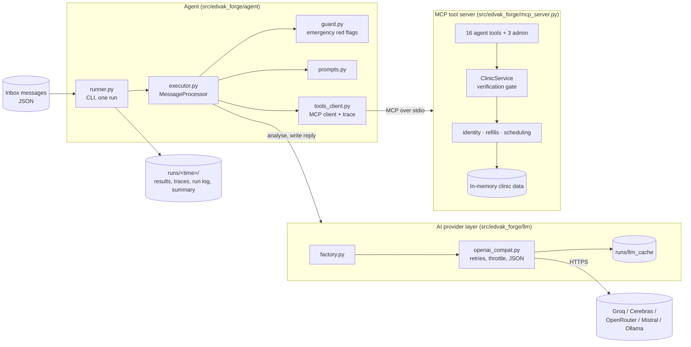

# Architecture

> **Status:** Complete. Tool server, AI layer, agent, evaluation harness, web API and dashboard are implemented and tested.

## What the system does

Edvak_forge works a clinic inbox. For each patient message it decides what the sender needs. It takes the allowed actions through the clinic's systems, hands anything risky to a human, and drafts a reply for staff to review.

## Components

### Deployed system

**How to read it.** The browser loads the dashboard and calls `/api/...` on the same host. The API owns one long-lived MCP connection to the tool server, so all requests share one live clinic state. Only the API talks to the AI provider, using a key stored in the platform's secret settings. See [ADR 0008](decisions/0008-dashboard-and-deployment.md) and [deployment.md](deployment.md).

### Agent internals

**How to read it.** The runner feeds messages one at a time to the `MessageProcessor`. The processor asks the guard about emergencies, asks the AI provider layer to analyse the message, then performs actions only by calling MCP tools. The tool server runs as a separate process and owns all clinic data and policy. Results and full traces are written to `runs/`.

| Component | Responsibility | Key decision |
|---|---|---|
| MCP tool server | Clinic data, policy enforcement, verification | [ADR 0004](decisions/0004-safety-and-policy-in-code.md), [ADR 0005](decisions/0005-verification-token.md) |
| Clinic rule modules | Refill, booking and identity rules as plain code | [ADR 0004](decisions/0004-safety-and-policy-in-code.md) |
| AI provider layer | One interface for any OpenAI-compatible provider | [ADR 0002](decisions/0002-llm-provider.md) |
| Guard | Deterministic emergency detection, safe reply template | [ADR 0004](decisions/0004-safety-and-policy-in-code.md) |
| Message processor | Guard, analyse, act, reply pipeline | [ADR 0006](decisions/0006-planner-executor-agent.md) |
| Runner | Batch runs, output files, crash safety net | |
| Evaluation harness | Scores runs against labels, checks every safety rule | [ADR 0007](decisions/0007-evaluation-design.md) |
| Web API | Live shared state, batch jobs, access token, serves the dashboard | [ADR 0008](decisions/0008-dashboard-and-deployment.md) |
| Dashboard | Inbox, new message, staff queues, schedule, evaluation, system | [ADR 0008](decisions/0008-dashboard-and-deployment.md) |

## Technology choices

| Technology | Why |
|---|---|
| Python 3.12 | Fast to write and test; official MCP SDK ([ADR 0001](decisions/0001-language-and-stack.md)) |
| MCP Python SDK v2 (`MCPServer`, `Client`) | The brief requires an MCP tool server; the official SDK supports stdio and in-process connections |
| Pydantic v2 | Validates data files, model output and the final result format |
| `openai` SDK against OpenAI-compatible endpoints | One adapter covers Groq, Cerebras, OpenRouter, Mistral and Ollama |
| Groq `gpt-oss-120b` (analysis) + `gpt-oss-20b` (replies) | Free, fast, supports strict JSON schema; separate per-model quotas double the budget |
| In-memory JSON data | Repeatable runs, nothing to install ([ADR 0003](decisions/0003-data-store.md)) |
| FastAPI + Uvicorn | Async, typed request validation, automatic API docs at `/api/docs` |
| React 19 + Vite + TypeScript + Tailwind CSS v4 | Mainstream, fast builds, static output hostable anywhere, token-based design system |
| Docker + Render free web service | One image for local production testing and hosting; one URL, no CORS |

## Where to go next

- [system-design.md](system-design.md) has the tool catalogue and rule locations.
- [workflows.md](workflows.md) walks through each kind of message.
- [error-handling.md](error-handling.md) covers what happens when things fail.
