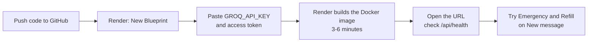

# Deployment guide

This guide takes you from "the code is on my computer" to "the app is live on the internet", for free. No previous deployment experience is assumed. Each step says what to do, why, and what you should see.

Free-tier facts below were checked against the official Render and Vercel documentation on 2026-10-18; Groq's daily token limit was confirmed from its own error message on 2026-10-18. Free tiers change, so glance at the linked pages before you start.

**Overview of the steps (Option A, recommended):**



## Which option should I choose?

| | **Option A: Render, one service** (recommended) | **Option B: Render API + Vercel dashboard** |
|---|---|---|
| What runs where | One Docker container on Render serves the dashboard and the API | API on Render (no Docker); dashboard on Vercel |
| Web addresses | One | Two |
| Extra setup | None | CORS and an API address variable |
| Cost | $0 | $0 |
| Best for | First-time deployers, demos | People who want the dashboard on Vercel's global CDN |

Both options use the same code. Option A was **tested locally with the exact Docker image Render builds**: health check, dashboard, deep links, access token, and a live AI call. Option B uses the same server code, but its two-host setup was not tested on the real platforms.

## What you need before you start

1. **The code on GitHub.** Render and Vercel deploy from a Git repository. This project is already a Git repository with commits, so you only need to save the latest changes and push.

   **a. Create an empty repository on GitHub.**
   Go to https://github.com/new, sign in, enter a name (for example `edvak-forge`), choose Private or Public, and click **Create repository**. **Don't** tick "Add a README", ".gitignore" or "license": the project already has them, and extra files would make the first push fail.
   *Expected result:* GitHub shows an empty repository page with its address, like `https://github.com/<you>/edvak-forge.git`.

   **b. Check that your secret key will not be uploaded.** In PowerShell, in the project folder:
   ```
   cd F:\Project1\Edvak_forge
   git check-ignore .env
   ```
   *Expected result:* it prints `.env`, meaning Git ignores the file. If it prints nothing, **stop** and don't push.

   **c. Save the latest changes in Git.**
   ```
   git add -A
   git status
   git commit -m "Edvak Forge submission"
   ```
   In the `git status` list, check that `.env`, `.venv/`, `runs/` and `frontend/node_modules/` are **not** listed (they're ignored), and that `reports/`, `data/` and `frontend/package-lock.json` **are** included: the deployment needs them. If Git asks "Please tell me who you are", run `git config --global user.name "Your Name"` and `git config --global user.email "you@example.com"` once, then commit again.

   **d. Push to GitHub.** Use the address from step a:
   ```
   git branch -M main
   git remote add origin https://github.com/<you>/edvak-forge.git
   git push -u origin main
   ```
   The first time, Windows opens a GitHub sign-in window; sign in and allow access. If it says `remote origin already exists`, run `git remote set-url origin <address>` instead of `git remote add`.
   *Expected result:* refreshing the GitHub page shows your files and the README. This link is also what you send to Edvak.
2. **A free Groq API key.** See [ai-integration.md](ai-integration.md#how-to-get-a-groq-key).
3. **An access token you make up**, for example a long random password. It stops strangers who find your URL from spending your AI quota. It's optional but recommended for a public URL.

## Important free-tier limits

| Platform | Limit | What it means for this app |
|---|---|---|
| Render free web service | Spins down after **15 minutes** without traffic. Waking takes **about one minute** | The first visit after a quiet period shows Render's loading page for about a minute. The dashboard allows for this |
| Render free web service | **750 free instance hours per month** per workspace | Enough for one service running all month |
| Render free web service | **Ephemeral filesystem**: local changes are lost on restart, redeploy or spin-down | Bookings, tickets and processed results reset when the service sleeps. This matches the brief ("changes only need to persist for a run"). The AI response cache also resets |
| Render free web service | Render may restart free services at any time; no shell access | Same as above |
| Render bandwidth and build minutes | Count against monthly included amounts. Without a payment method, the service is suspended if exceeded | Not an issue for a demo |
| Vercel Hobby | Free, **personal and non-commercial use only**. 100 GB transfer and 100 deployments per day | Fine for a take-home project or demo |
| Groq free plan | Per model and **per account**: 1,000 requests/day, 8,000 tokens/minute, **200,000 tokens/day** (rolling 24 hours). A new key in the same Groq account shares the same allowance | One fresh 40-message run uses about half a day's allowance on the main model. A new deployment has no saved AI answers, so **Process all** on a fresh deployment always costs that much. Use the access token so strangers can't use it up |

Sources: [Render free instances](https://render.com/docs/free), [Render web services](https://render.com/docs/web-services), [Render Blueprint spec](https://render.com/docs/blueprint-spec), [Vercel Hobby plan](https://vercel.com/docs/plans/hobby).

Nothing in this app needs a database, background worker or paid service.

---

## Option A: one service on Render (recommended)

### A1. Create a Render account
Go to https://render.com and sign up with GitHub. Signing up with GitHub lets Render see your repositories.
*Expected result:* you land on the Render dashboard.

### A2. Create the service from the Blueprint
The repository contains `render.yaml`, a **Blueprint** that describes the service: free plan, built from the `Dockerfile`, with a health check at `/api/health`.

1. In the Render dashboard click **New +**, then **Blueprint**.
2. Connect your GitHub repository and select it.
3. Render reads `render.yaml` and shows one service called `edvak-forge`. It asks for the values marked secret:
   - `GROQ_API_KEY`: paste your Groq key.
   - `DEMO_ACCESS_TOKEN`: paste the access token you made up, or leave it empty to allow anyone to run the agent.
4. Click **Apply** (or **Deploy Blueprint**).

*Why a Blueprint:* every setting lives in the repository, so nothing has to be typed by hand and redeploys are identical.

*Expected result:* Render starts a build. The **Logs** tab shows the dashboard being built with `npm`, then the Python packages installing, then `Uvicorn running on http://0.0.0.0:10000`. The first build takes about 3–6 minutes.

### A3. Open the app
When the status turns **Live**, click the URL at the top, for example `https://edvak-forge.onrender.com`.
*Expected result:* the dashboard opens on the Inbox. The bottom of the sidebar (or the top bar on a phone) shows a green dot and **AI: groq**.

### A4. Verify the deployment
Do these in order. Each one tests a different part.

| Check | How | Expected |
|---|---|---|
| API health | Open `https://<your-app>.onrender.com/api/health` | JSON with `"status":"ok"` and `"configured":true` |
| Access token | On the **System** page, paste your token and click **Save** | "Access token saved for this tab." |
| Single message | **New message**, click the **Emergency** example, then **Process message** | Red "Possible emergency" banner; reply tells the patient to call 911 |
| AI path | Click the **Refill** example, then **Process message** | Action "Prepare refill for approval", and a friendly reply naming Lisinopril |
| Batch | **Inbox**, then **Process all**, then **Start** | Progress bar; about 8 minutes on a cold cache; ends with "Processed 40 messages" |
| Evaluation | **Evaluation** page | Published scores, e.g. emergency recall 100% |

### A5. Logs, redeploys and rollback
- **Logs:** open the service in Render, then **Logs**. Every processed message is logged with its urgency and actions. Errors show a full traceback.
- **Redeploy:** pushing to `main` redeploys automatically (`autoDeployTrigger: commit`). To redeploy by hand: **Manual Deploy**, then **Deploy latest commit**.
- **Rollback:** open **Events**, find an earlier successful deploy, and click **Rollback**.
- **Change a setting or key:** **Environment**, edit the value, then **Save Changes**. Render restarts the service with the new value.

### A6. Before a live demo or interview
1. **Wake the service 5 minutes early.** Open the app URL; a sleeping free service takes about a minute to wake. Keep the tab open: activity keeps it awake.
2. **Check `/api/health`** shows `"configured":true`.
3. **Don't use Process all on the deployed app that day.** It costs about half the daily AI allowance on a fresh deployment. Single messages on **New message** cost very little (about 3,000 tokens each). If you want the full inbox processed for the demo, do it the day before, or show the published results on the **Evaluation** page instead.
4. **Have a fallback ready.** If the main model's daily allowance runs out, set `LLM_MODEL` to `openai/gpt-oss-20b` under **Environment** and save. That model has its own allowance. Emergencies are escalated even with no AI at all.
5. **Remember the data resets** when the service sleeps or restarts. That's expected (the brief only needs changes to last for a run).

---

## Option B: API on Render, dashboard on Vercel

### B1. API on Render (without Docker)
1. In Render: **New +**, then **Web Service**, and pick your repository.
2. Settings:

   | Field | Value |
   |---|---|
   | Language / Runtime | Python 3 |
   | Build Command | `pip install -e .` |
   | Start Command | `python -m edvak_forge.api` |
   | Instance Type | Free |
   | Health Check Path (under Advanced) | `/api/health` |

3. Environment variables:

   | Key | Value |
   |---|---|
   | `PYTHON_VERSION` | `3.12.10` |
   | `LLM_PROVIDER` | `groq` |
   | `GROQ_API_KEY` | your key |
   | `DEMO_ACCESS_TOKEN` | your access token (optional) |
   | `ALLOWED_ORIGINS` | your Vercel URL from step B2, e.g. `https://edvak-forge.vercel.app` (fill in after B2) |

4. **Create Web Service.** *Expected result:* status **Live**, and `https://<api>.onrender.com/api/health` returns `"status":"ok"`.

### B2. Dashboard on Vercel
1. Sign up at https://vercel.com with GitHub.
2. **Add New…**, then **Project**, and import your repository.
3. Set **Root Directory** to `frontend`. Vercel detects Vite. `frontend/vercel.json` sets the build command, the `dist` output folder, and a rewrite so deep links like `/evaluation` work.
4. Under **Environment Variables**, add `VITE_API_BASE_URL` = `https://<api>.onrender.com`, with no trailing slash.
5. **Deploy.** *Expected result:* a URL such as `https://edvak-forge.vercel.app`.

### B3. Connect the two
Go back to Render and set `ALLOWED_ORIGINS` to the exact Vercel URL from B2. This tells the API which website may call it (CORS). Save, and wait for the restart.
*Expected result:* the Vercel dashboard shows **AI: groq** and the inbox loads. Then run the checks in A4.

Note that `VITE_API_BASE_URL` is built into the dashboard at build time. If you change it, redeploy on Vercel.

---

## Running the production build locally (optional)

This is the same image Render builds, and it's useful to check a change before pushing:

```bash
docker build -t edvak-forge .
docker run --rm -p 10000:10000 --env-file .env edvak-forge
```

Open http://localhost:10000.

## Troubleshooting deployments

| Symptom | Likely cause | Fix |
|---|---|---|
| Build fails at `npm ci` | `frontend/package-lock.json` missing from the repo | Commit it; it must be in Git |
| Build fails at `pip install` | Old Python on a non-Docker service | Set `PYTHON_VERSION=3.12.10` (Option B) |
| Deploy fails "health check" | App not listening on Render's port | Don't override `PORT`. The app reads it automatically (default 10000) |
| Page shows Render's "waking up" screen | Free service was asleep | Wait about one minute; this is normal |
| Banner "AI provider is not configured" | `GROQ_API_KEY` missing or wrong | Set it under **Environment** and save |
| "This action needs the access token" | `DEMO_ACCESS_TOKEN` is set on the server | Paste the token on the **System** page |
| Vercel dashboard says "Cannot reach the server" | Wrong `VITE_API_BASE_URL`, or API asleep | Check the URL (no trailing slash), open `/api/health` to wake it, redeploy Vercel after changes |
| Browser console shows a CORS error | `ALLOWED_ORIGINS` doesn't exactly match the Vercel URL | Copy the URL exactly, including `https://`, with no trailing slash |
| Evaluation page shows "No reports published" | `reports/` not in the repo, or the package was installed without `-e` (Option B) | Commit `reports/`; use `pip install -e .`, or set `EDVAK_HOME` to the repo folder |
| Results vanished | The service slept or restarted (ephemeral filesystem) | Expected on the free tier; process the messages again |
| Runs stop with many hand-offs to humans; logs show `rate limited (attempt n/5)` | Groq's daily token limit (200,000 per model, per account) is used up | A new key from the same account won't help. Wait for the rolling 24-hour window, or set `LLM_MODEL=openai/gpt-oss-20b`, or switch `LLM_PROVIDER` (see [ai-integration.md](ai-integration.md)) |
| `git push` rejected: "fetch first" or "unrelated histories" | The GitHub repository was created with a README or other files | Create a new **empty** repository (no README, no .gitignore) and push again |
| `git push` asks for a password and rejects it | GitHub no longer accepts account passwords for Git | Use the sign-in window that opens on Windows, or create a personal access token on GitHub and use it as the password |

More general problems are covered in [troubleshooting.md](troubleshooting.md).

## Security checklist for a public URL

- `GROQ_API_KEY` is set only in the platform's environment settings, never in the repository.
- `DEMO_ACCESS_TOKEN` is set, so strangers can view but not spend your quota or reset data.
- The data is synthetic. **Never** put real patient data into this deployment. See [security.md](security.md) for what would need to change first.
