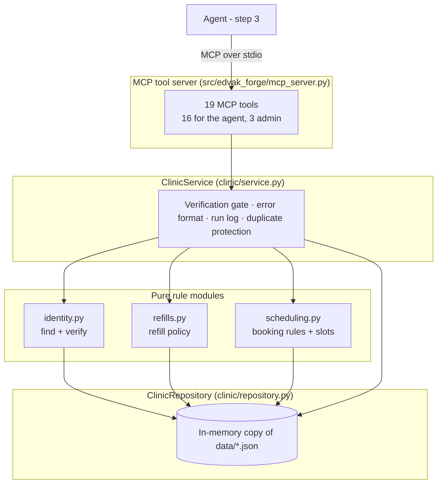

# System design

> **Status:** The data layer, clinic rules, service layer and MCP tool server are implemented and tested (step 2). The agent, evaluation harness, API and frontend are not built yet. Sections for them are added as they are built.

## Layers



**How to read it.** The agent only ever talks to the MCP server. Each tool is a thin wrapper that calls one `ClinicService` method. The service checks verification, validates inputs, calls the pure rule modules, and records what happened in the run log. The rule modules hold the clinic policy and have no side effects, so they are easy to test. The repository is a fresh in-memory copy of the JSON files.

| Layer | File | Responsibility |
|---|---|---|
| Models | `clinic/models.py` | Pydantic models that validate every data file on load |
| Repository | `clinic/repository.py` | Load data, look up records, add appointments |
| Identity rules | `clinic/identity.py` | Normalise names and phones, find patients, verify senders |
| Refill rules | `clinic/refills.py` | Refill policy, medication name matching (brand and Spanish names) |
| Scheduling rules | `clinic/scheduling.py` | Booking rule checks and free-slot search |
| Service | `clinic/service.py` | Tool operations, verification tokens, run log, consistent errors |
| MCP server | `mcp_server.py` | Exposes the service as MCP tools with typed, described parameters |

## Tool catalogue

Tools marked 🔒 need a `verification_token` from `verify_sender` (see ADR 0005).

| Tool | Purpose | Key rules enforced |
|---|---|---|
| `find_patient` | Find records by name, phone, email, DOB. Also matches caregivers. | Exact match after normalisation. No fuzzy matching. |
| `verify_sender` | Decide if the sender may access a patient's data. Issues the token. | Contact on file, or name + DOB. Wrong DOB always fails. |
| `get_patient_profile` 🔒 | First name, age, primary provider, last visit, language, caregiver | |
| `get_medications` 🔒 | Active medications with run-out dates | |
| `check_refill_eligibility` 🔒 | Refill policy decision per medication | All five policy rules, earliest request date |
| `prepare_refill_request` 🔒 | Queue a refill for provider approval | Refuses anything not eligible. One request per medication per run. |
| `list_appointments` 🔒 | Upcoming booked appointments | |
| `find_free_slots` | Bookable slots by visit type, dates, provider, morning/afternoon | Every slot passes all booking rules. Notes leave and holidays. |
| `book_appointment` 🔒 | Book a slot | Returns the list of violated rules if refused |
| `reschedule_appointment` 🔒 | Move an appointment | New slot booked before old one cancelled, so failure changes nothing |
| `cancel_appointment` 🔒 | Cancel | Only the patient's own appointment. Cancelling twice is harmless. |
| `get_clinic_info` | Hours, holidays, providers, leave, visit lengths | Public information only |
| `check_clinic_open` | Open on a date? Who is on leave? | |
| `route_to_queue` | Create a ticket for a human queue | Only the five real queues. One ticket per message per queue. |
| `draft_reply` | Save the reply for staff review | Latest draft replaces earlier ones |
| `flag_suspicious_instruction` | Flag prompt-injection attempts | |
| `admin_reset_state` | Reload data, clear the log | Harness only |
| `admin_set_clock` | Set simulated "now" to the message time | Harness only |
| `admin_get_run_log` | Read tickets, refill requests, drafts, flags, changes | Harness only |

## Tool result format

Every tool returns JSON in one of two shapes, so the agent always knows whether it worked and why not:

```json
{"ok": true, "slots": [ ... ], "count": 3, "notes": ["Dr. James Okafor (OKAFOR) is on leave 2026-11-16 to 2026-11-20"]}
```

```json
{"ok": false, "error": {"code": "slot_not_bookable", "message": "This slot cannot be booked. Use find_free_slots to offer alternatives.", "violations": ["provider_already_booked"]}}
```

Expected problems never raise exceptions. Invalid enum values (for example an unknown queue name) are rejected by the MCP input schema before the tool runs.

## Key rules and where they live

| Rule (clinic.json) | Implementation |
|---|---|
| Refill eligible only if on list, not controlled, seen in 12 months, refills > 0, within 7 days of run-out | `refills.check_refill` |
| Controlled substances always go to the provider | `check_refill` returns `controlled_substance` first, whatever else fails |
| Too early: tell the earliest date | `earliest_request_date = last_filled + days_supply - 7` |
| Starts on :00/:20/:40; no lunch, holidays, leave; no overlaps | `scheduling.booking_violations` |
| Visit lengths | `visit_types` minutes added to the start time |
| Verification = name + DOB, or contact on file | `identity.verify_sender` |

## Design calls made in this step

- **Caregiver verification by name + DOB** uses the caregiver's name with the *patient's* date of birth. The policy does not say this explicitly.
- **No bookings beyond 27 Nov 2026**, the last day in the schedule data. Booking later could double-book a slot we cannot see.
- **Same-day slots respect the message time.** The harness sets a simulated clock to each message's arrival time.
- **Medication matching** knows common brand names (Xanax, Ambien, Lipitor and others) and Spanish spellings (metformina). Unknown names match nothing, which leads to routing to the provider rather than guessing.
