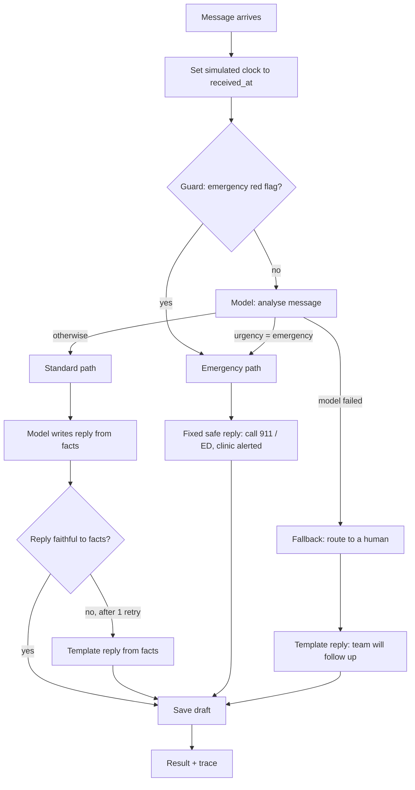
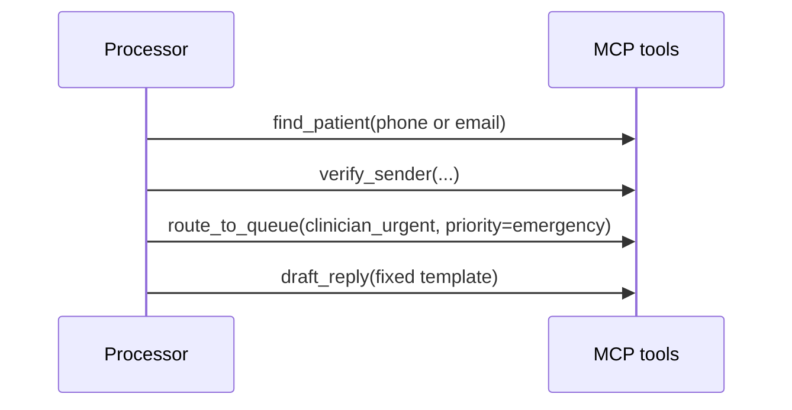
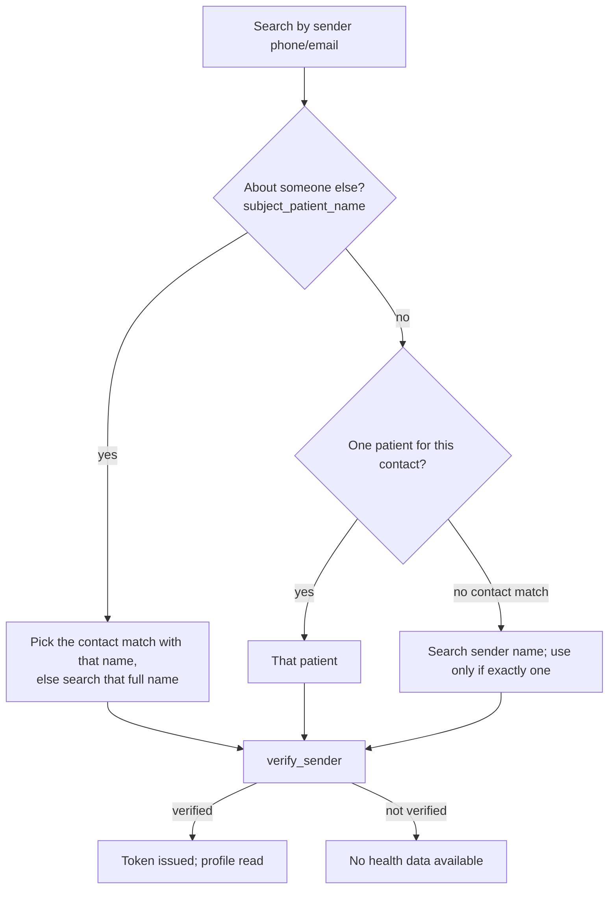
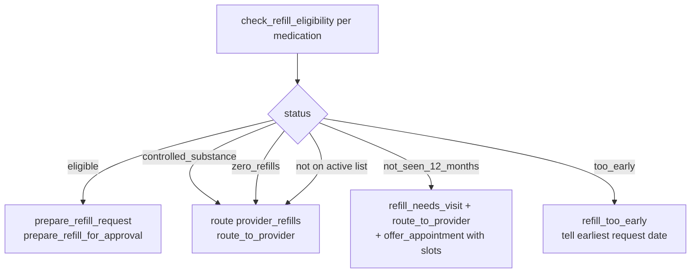

# Workflows

How one message travels through the agent, and what each kind of request does. Every diagram matches the code in `src/edvak_forge/agent/executor.py`.

## 1. Every message: the main pipeline

**What happens.** The simulated clock makes "today" slot searches skip times that have already passed. The guard runs first, so an emergency is escalated even if the AI provider is down. If the model's analysis fails, the message still reaches a human. Standard replies are checked for faithfulness: no dropped or invented dates and times.

## 2. Emergency path

Result: `urgency = emergency`, `actions = [escalate_emergency]`, `routed_to = [clinician_urgent]`. No refill, booking or other action is taken, and the reply is never model-written. The patient is identified from the sender's phone or email, including an authorised caregiver's phone.

## 3. Identifying and verifying the sender

A sender is verified by writing from the phone or email on file for the patient or their caregiver, or by giving a name with the matching date of birth. An unverified sender asking about a different named person is treated as a **third party** and gets `decline_disclosure`, whatever role the model guessed. Other unverified requests for health data get `request_verification`. The reply never confirms whether a record exists.

## 4. Refill request

Brand names (Xanax) and Spanish names (metformina) are matched to the generic name on file. "All my medications" checks every active medication. The tool refuses to prepare anything not eligible, so a model mistake can't create an invalid refill.

## 5. Booking, rescheduling, cancelling

- **Book.** If a specific time was requested, the agent tries that exact slot. If it is taken, it offers the three closest times that day, then later days (`offer_alternatives`). Without a specific time, it searches the requested window with the requested provider, otherwise the primary provider, otherwise anyone, and books the first slot (`book_appointment`). If nothing fits, for example because the provider is on leave, it explains why and offers other providers in the window or the same provider later.
- **Sick visits** with no date are searched today through the next business day, following the "within 1 business day" rule.
- **Reschedule.** The agent finds the existing appointment on the stated date, then a new slot with the same provider and visit type, and moves it. The new slot is booked before the old one is cancelled, so a failure changes nothing.
- **Cancel.** If exactly one appointment matches, it is cancelled. If several match, the agent asks which one instead of guessing (`acknowledge`). The sample message from Hannah Lee hits this case.
- **New patients.** The agent answers that the clinic accepts new patients and offers new-patient slots from the next business day (`answer_directly`, `offer_new_patient_booking`). It doesn't book, because there is no patient record yet.

## 6. Questions, billing, records, admin, clinical

| Request | What happens | Action and queue |
|---|---|---|
| Clinic hours | Answered from clinic data | `answer_directly` |
| Open on a date | `check_clinic_open`; holidays explained | `answer_directly` |
| Billing, balance, copay | Never answered (no billing data) | `route_to_billing` → billing |
| Records request (verified) | Front desk handles it | `route_to_front_desk` → front_desk |
| Contact detail change (verified) | Front desk updates | `route_to_front_desk` → front_desk |
| Health question or symptoms, no booking made | Clinician reviews; no advice in the reply | `route_to_clinician` → clinician_routine, or clinician_urgent if urgent |
| Low mood (guard) | Urgency at least urgent, clinician today, crisis line in reply | `route_to_clinician` → clinician_urgent |
| Prompt injection | Flagged, then the real request is handled under normal policy | `flag_suspicious_instruction` |
| Thanks | Warm acknowledgement | `acknowledge` |
| Spam | Nothing; no reply | `no_action` |
| Anything else | Front desk | `route_to_front_desk` |
